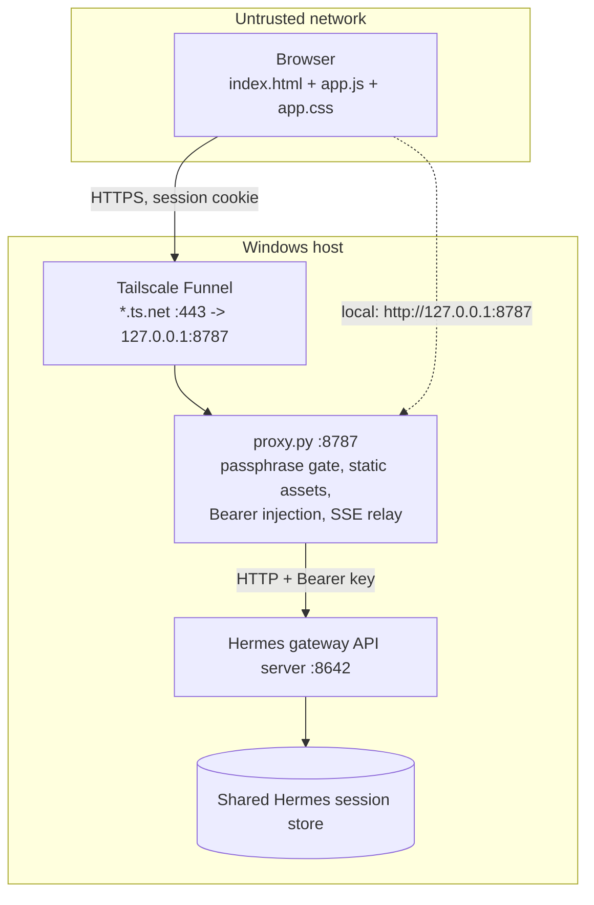
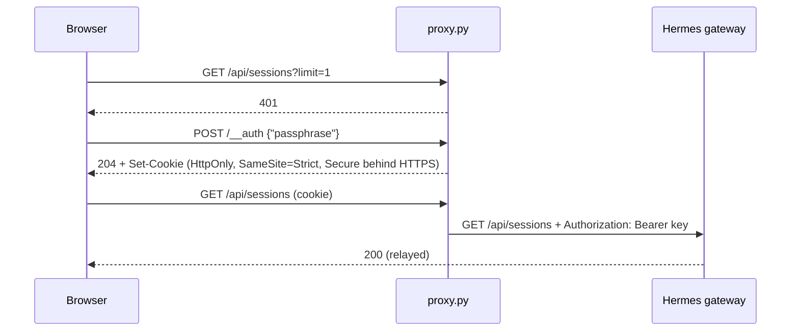

# Hermes Uplink: Architecture

Uplink is a zero-build browser client plus a loopback-only proxy for [Hermes Agent](https://hermes-agent.nousresearch.com/). The proxy gates access with a passphrase, injects the Hermes API key server-side, and serves the pinned static client. Internet exposure is owned entirely by Tailscale Funnel; nothing in this repository stores tunnel credentials.

Design constraints:

- **No build step.** Plain HTML, CSS and JS with one vendored dependency (`marked`); Python standard library only.
- **Loopback only.** The proxy binds 127.0.0.1; the API key never reaches the browser.
- **Pinned assets.** Served files are authorized by SHA-256 digests; the proxy refuses to start if they drift.
- **Shared sessions.** Sessions live in the Hermes store, so Uplink, CLI, TUI and cron see the same conversations.
- **Frugal connectivity.** No background polling: refresh on focus/visibility, last-render cache, draft autosave, SSE keepalive.

## Components



| File | Role |
|---|---|
| [proxy.py](proxy.py) | Reverse proxy, auth gate, static server, digest verification |
| [pinned-hashes.json](pinned-hashes.json) | Pinned SHA-256 digests of every served script/page/style (written by `--update-hashes`) |
| [uplink_common.py](uplink_common.py) | Defaults and health-probe header shared by the two Python entry points |
| [internet_access.py](internet_access.py) | Tailscale Funnel lifecycle: status parsing, ownership guard, consent URL handling |
| [console_utils.py](console_utils.py) | Re-enables QuickEdit selection in the Windows console |
| [index.html](index.html), [app.css](app.css), [app.js](app.js) | Client markup, styles, logic |
| [sw.js](sw.js), [manifest.webmanifest](manifest.webmanifest) | PWA installability; the worker caches only the manifest, itself and `marked`, and never `index.html` or API calls |
| [launch_local.bat](launch_local.bat) | Configures Hermes, generates `.uplink-key.txt` / `.uplink-pass.txt`, restarts the gateway, runs the proxy; also `install`/`start`/`stop`/`status` for login auto-start |
| [autostart.vbs](autostart.vbs), [service.ps1](service.ps1) | Headless start at login; PID-checked stop/status |
| [launch_internet.bat](launch_internet.bat) | Wrapper for `internet_access.py` |

The proxy takes the API key and passphrase from the `HERMES_API_KEY` and `UPLINK_PASSPHRASE` environment variables; the launchers read them from the git-ignored secret files.

## Authentication and sessions

`/api/*`, `/v1/*` and `/health` require a session cookie. The browser probes `/api/sessions`; a transport failure shows the offline banner, a `401` shows the passphrase modal.



Passphrase failures are limited to 10 per 60 s per client address (the correct passphrase is never locked out). Sessions last 12 h, at most 256 at a time. At most 32 proxy requests run concurrently (excess get `503`) and 128 connections (excess are dropped).

## Streaming

The client opens `POST /api/sessions/{id}/chat/stream` with `Idempotency-Key` / `X-Client-Turn-ID` set to a per-draft UUID that is kept until the stream is established, so a retried send reuses it. The proxy relays the SSE body unbuffered, closes the connection to delimit it, and writes `: ping` every 15 s of upstream silence to keep cellular NAT mappings alive; the client ignores comment frames.

Frames consumed by `handleFrame` (the gateway is authoritative): `assistant.delta {delta}`, `assistant.commentary {text, already_streamed}`, `assistant.completed {content}`, `tool.started` / `tool.completed` / `tool.failed {tool_name, preview, args}`, `error {message}`, `run.completed`, and the clarify events below. Frames carry `run_id`; Stop aborts the fetch and calls `POST /v1/runs/{run_id}/stop`.

Streams are tracked per session (`streams` map). Leaving a session parks its thread nodes in a detached holder, the stream keeps writing there, and the session row shows "new reply" or "question waiting" until the user returns. `localThread` marks threads holding stream-built content so passive refreshes do not overwrite them.

Clarify (interactive questions) is specified in [docs/clarify-protocol.md](docs/clarify-protocol.md).

## Client state

- **Sidebar:** a drawer below 768 px or in portrait; pinnable at ≥1024 px or ≥768 px landscape (preference in `localStorage`, applied synchronously to avoid layout shift). The main header collapses to two rows plus a More menu by container width.
- **Drafts:** saved per session in `localStorage`; cleared only once a stream is established; reconciled against history so a send that reached the server is not repeated.
- **Last-render cache:** `sessionRenderCache` per session; a failed history fetch never blanks an existing thread.
- **Unread:** the session list carries `unread`; opening a session PATCHes `{unread:false}` after history loads. A local write guard (10 s) stops a stale list page from flipping it back. Design: [docs/mobile-edge-ux-and-session-status-spec.md](docs/mobile-edge-ux-and-session-status-spec.md).

## Security model

| Threat | Control |
|---|---|
| Unauthenticated public ingress | Funnel terminates TLS; proxy passphrase gate with constant-time compare and attempt limiting |
| API key exfiltration | Key stays in the proxy process; the browser holds only an opaque cookie |
| Tampered or injected scripts | Digest-pinned files; CSP `default-src 'none'`, `connect-src 'self'`, `script-src 'strict-dynamic'` with the `app.js` and `marked` digests, `script-src-attr 'none'`; `index.html` loads both scripts with matching SRI |
| Path traversal in static serving | Fixed file allowlist plus `vendor/` and `assets/` directories, resolved with `realpath` |
| Host pivoting | Loopback bind only; non-loopback upstreams require `--allow-remote-upstream` and HTTPS |
| Overwriting another Funnel/Serve config | `matching_uplink_route` refuses any other public route on 443; cleanup disables only a verified Uplink route |

Because of the CSP, UI code must not use inline `<script>`, inline `style=""` attributes or `onclick=""`; use classes and `addEventListener`. CSSOM writes such as `style.setProperty` are allowed.

## Funnel lifecycle

`launch_internet.bat start` calls `internet_access.py start`, which: ensures the local proxy is healthy (starting `launch_local.bat` if not), loads the passphrase, ensures Tailscale is signed in (opening the consent URL it prints), reads `tailscale funnel status --json`, and either accepts the existing Uplink route, fails closed on a foreign route, or runs `tailscale funnel --bg --yes --https=443 http://127.0.0.1:<port>` and re-verifies. `status` and `cleanup` use the same ownership check.

## Operations

After editing `index.html`, `app.js`, `app.css` or `sw.js`:

```powershell
python proxy.py --update-hashes   # rewrites pinned-hashes.json and index.html's SRI digests
python proxy.py --check-hashes    # exit 1 on drift
python -m unittest discover -s tests -v
```

Text assets are hashed and served with LF line endings, so a CRLF checkout does not break SRI. Manual probes:

```powershell
curl -s http://127.0.0.1:8642/health                       # gateway
curl -s -i http://127.0.0.1:8787/api/sessions              # expect 401
powershell -NoProfile -File .\service.ps1 -Action status -Port 8787
python internet_access.py status
```
