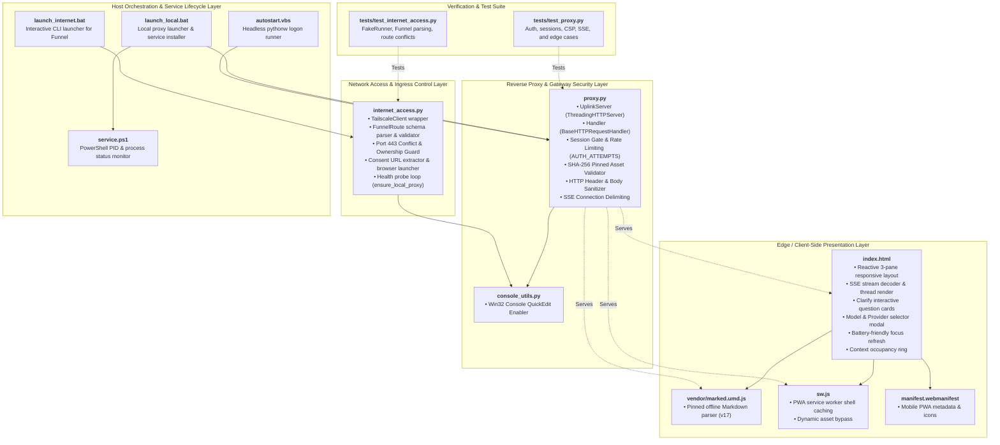
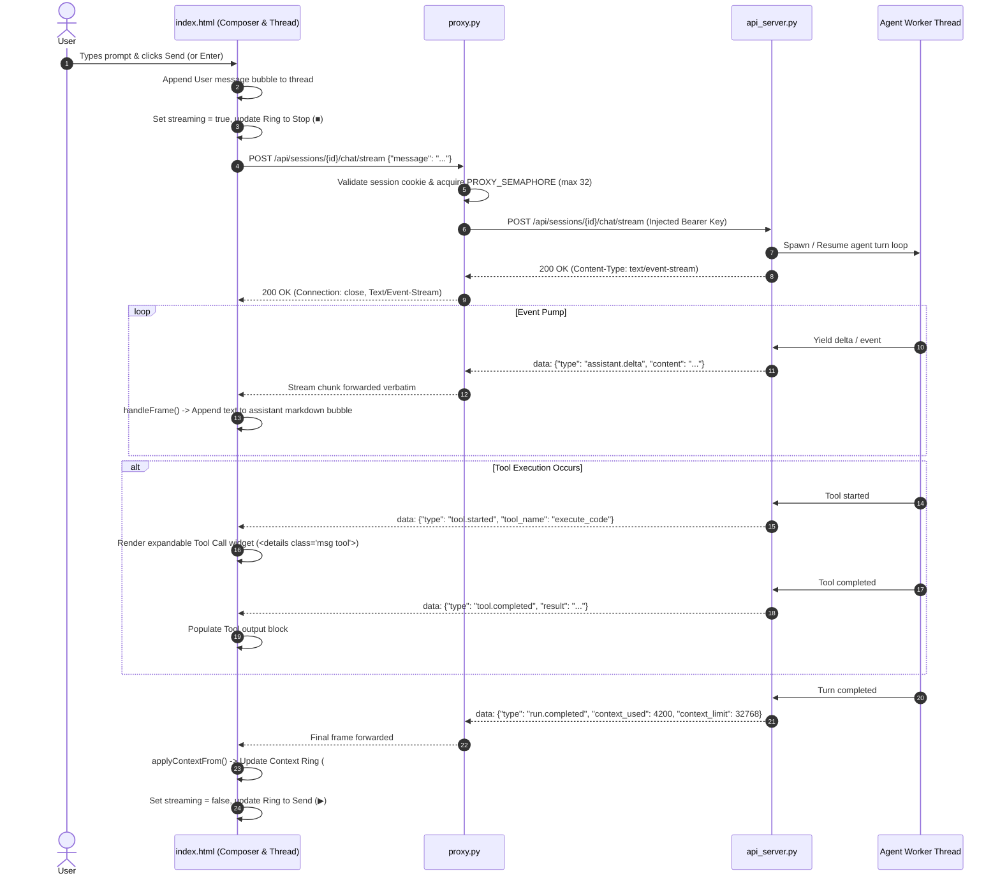
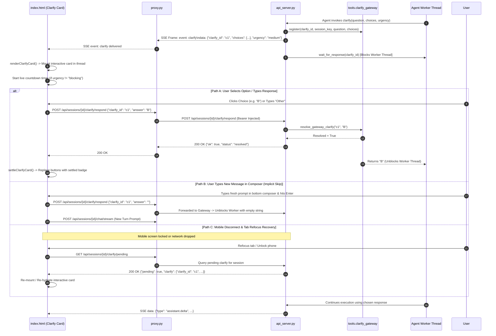

# 📐 Hermes Uplink — System Architecture & Technical Topology

This document provides a comprehensive, multi-resolution architectural reference for **Hermes Uplink**. It is designed to give maintainers, contributors, and systems engineers an immediate, high-fidelity understanding of the codebase structure, execution boundaries, communication contracts, and security invariants.

---

## 1. System Overview & Core Design Tenets

Hermes Uplink is a data-efficient, zero-build "thin client" and secure reverse-proxy gateway for [Hermes Agent](https://hermes-agent.nousresearch.com/). It enables remote interaction with a local Hermes runtime from mobile and edge browsers without exposing private files, LLM API keys, or raw terminal environments.

```
┌───────────────────────────────────────────────────────────────────────────────────────────────────────┐
│                                         CORE DESIGN PRINCIPLES                                        │
├───────────────────────────────┬───────────────────────────────┬───────────────────────────────────────┤
│ 1. Zero Build Steps           │ 2. Loopback Isolation         │ 3. Provider Discipline                │
│ Single vanilla HTML/JS file   │ Proxy listens strictly on     │ Internet exposure is owned exclusively│
│ with vendored dependencies;   │ 127.0.0.1; LLM API keys never │ by Tailscale Funnel. No tunnel        │
│ no npm, webpack, or node.js.  │ reach the client browser.     │ binaries or credentials in repo.      │
├───────────────────────────────┼───────────────────────────────┼───────────────────────────────────────┤
│ 4. Single Source of Truth     │ 5. Pinned Integrity Guard     │ 6. Battery-Conscious Sync             │
│ Shares `%LOCALAPPDATA%\hermes\`│ Static assets are SHA-256     │ Uses on-focus/visibility convergence  │
│ sessions with CLI, TUI, cron. │ hash-verified at proxy boot.  │ rather than aggressive poll loops.    │
└───────────────────────────────┴───────────────────────────────┴───────────────────────────────────────┘
```

---

## 2. C4 Architecture Diagrams

### Level 1: System Context & Trust Boundaries

The diagram below illustrates the physical boundaries, networks, external platforms, and security perimeters separating the edge client, the host operating system, and the upstream Hermes core.

```mermaid
flowchart TB
    subgraph WAN["Public Internet / Untrusted Network"]
        direction TB
        EDGE["Edge Browser Client<br/><b>(Mobile iOS/Android, Laptop, Tablet)</b><br/><i>PWA Shell / Vanilla JS / DOM</i>"]
    end

    subgraph TS_CLOUD["Tailscale Infrastructure"]
        TS_FUNNEL["Tailscale Funnel Ingress<br/><b>*.ts.net (Port 443)</b><br/><i>TLS Termination & Route Forwarding</i>"]
    end

    subgraph HOST["Host Desktop Boundary (Windows 10/11 Host Machine)"]
        direction TB

        subgraph SEC_NET["Loopback Network Interface (127.0.0.1)"]
            direction TB
            TS_DAEMON["Tailscale Client Service<br/><b>tailscale.exe / IPN</b><br/><i>Background Tunnel Route Manager</i>"]
            
            PROXY["Hermes Uplink Proxy<br/><b>proxy.py (:8787)</b><br/><i>• Passphrase Gate & Session Auth<br/>• Static Asset Integrity (SHA-256)<br/>• Upstream Bearer Token Injection<br/>• Concurrency & Rate Limiting</i>"]
            
            GATEWAY["Hermes Core Gateway & API Server<br/><b>api_server.py (:8642)</b><br/><i>• LLM Orchestration & Agent Loops<br/>• Tool Execution Engine<br/>• Clarify State Machine & Gateway</i>"]
        end

        subgraph DISK["Host Storage / Local Filesystem"]
            SECRETS["Repository Secret Files<br/><b>.uplink-key.txt</b> (API Bearer)<br/><b>.uplink-pass.txt</b> (Passphrase)<br/><b>.uplink.pid</b> (Process ID)"]
            SESSIONS[("Shared Hermes Store<br/><b>%LOCALAPPDATA%\hermes\sessions\</b><br/><i>JSON / SQLite Session Records</i>")]
            HERMES_CONF["Hermes Global Config<br/><b>~/.hermes/config.yaml</b><br/><i>API_SERVER_ENABLED: true</i>"]
        end

        subgraph CTRL["Control Plane & Service Automation"]
            LAUNCH_INT["launch_internet.bat<br/><b>internet_access.py</b><br/><i>Funnel Lifecycle & Verification</i>"]
            LAUNCH_LOC["launch_local.bat<br/><b>service.ps1</b> / <b>autostart.vbs</b><br/><i>Service & Startup Management</i>"]
        end
    end

    %% Network & IPC flows
    EDGE <== "HTTPS / TLS 1.3 (Port 443)<br/>[No API Key, Passphrase Cookie]" ==> TS_FUNNEL
    TS_FUNNEL <== "Encrypted WireGuard Mesh" ==> TS_DAEMON
    TS_DAEMON <== "HTTP / 1.1 Forwarding<br/>http://127.0.0.1:8787" ==> PROXY
    EDGE -.->|"Optional Direct LAN / Local Loopback"| PROXY

    PROXY <== "HTTP / 1.1 REST + SSE<br/>+ Header Authorization: Bearer &lt;KEY&gt;" ==> GATEWAY
    GATEWAY <-->|"Read / Write Sessions"| SESSIONS
    LAUNCH_LOC -.->|"Configures"| HERMES_CONF
    LAUNCH_LOC -.->|"Generates / Reads"| SECRETS
    PROXY -.->|"Loads Secrets & PID"| SECRETS
    LAUNCH_INT <-->|"CLI Subprocess Control"| TS_DAEMON
    LAUNCH_INT -.->|"Health Probes"| PROXY

    %% Styling classes
    classDef edgeClass fill:#1f6feb15,stroke:#1f6feb,stroke-width:2px;
    classDef tunnelClass fill:#bc8cff15,stroke:#bc8cff,stroke-width:2px;
    classDef proxyClass fill:#f0a50015,stroke:#f0a500,stroke-width:2px;
    classDef gatewayClass fill:#3fb95015,stroke:#3fb950,stroke-width:2px;
    classDef storageClass fill:#21262d,stroke:#30363d,stroke-width:1px;

    class EDGE edgeClass;
    class TS_FUNNEL,TS_DAEMON tunnelClass;
    class PROXY proxyClass;
    class GATEWAY gatewayClass;
    class SECRETS,SESSIONS,HERMES_CONF storageClass;
```



---

### Level 2: Component Architecture & Codebase Shape

The codebase is intentionally lean and modular, relying strictly on standard libraries (Python standard library, Windows scripting host, native Web APIs).



---

## 3. Detailed Runtime Sequence Flows

### 3.1 Authentication & Session Gate Flow

Before any proxy routes (`/api/*`, `/v1/*`, `/health`) are accessible, the browser must clear the passphrase gate.

```mermaid
sequenceDiagram
    autonumber
    actor User as User (Edge Browser)
    participant Client as index.html
    participant Proxy as proxy.py (:8787)
    participant Upstream as Hermes Gateway (:8642)

    User->>Client: Open URL (https://node.tailnet.ts.net/)
    Client->>Proxy: GET /api/sessions?limit=1 (Initial Probe)
    Proxy-->>Client: 401 Unauthorized (Missing/invalid session cookie)
    Client->>Client: Display Passphrase Modal (#authModal)
    User->>Client: Types Passphrase & hits Connect
    Client->>Proxy: POST /__auth {"passphrase": "..."}
    
    alt Passphrase Incorrect
        Proxy->>Proxy: Increment AUTH_ATTEMPTS (Rate limit: 10/60s)
        Proxy-->>Client: 401 Unauthorized or 429 Too Many Requests
        Client->>User: Display error message on modal
    else Passphrase Correct
        Proxy->>Proxy: Clear failure records & generate secrets.token_urlsafe(32)
        Proxy->>Proxy: Store in SESSIONS[token] = now + 12h TTL
        Proxy-->>Client: 204 No Content<br/>Set-Cookie: hermes_uplink_session=...; HttpOnly; SameSite=Strict; Path=/
        Client->>Client: Hide Modal, invoke boot()
        Client->>Proxy: GET /api/sessions (Cookie attached)
        Proxy->>Proxy: Validate token in SESSIONS map
        Proxy->>Upstream: GET /api/sessions (Add Header "Authorization: Bearer <KEY>")
        Upstream-->>Proxy: 200 OK [{"id": "s1", ...}]
        Proxy-->>Client: 200 OK [{"id": "s1", ...}]
        Client->>User: Render session sidebar & active chat
    end
```

---

### 3.2 Turn Streaming & SSE Pipeline Flow

When the user dispatches a message, Uplink opens a persistent connection and streams Server-Sent Events from the Hermes runtime.



---

### 3.3 Interactive Clarify (Multiple-Choice) Protocol Flow

When the agent requires human feedback mid-execution, it emits a `clarify` frame. Uplink presents an interactive card, allowing the user to unblock the agent asynchronously.



---

### 3.4 Internet Access & Tailscale Funnel Control Lifecycle

The internet access subsystem ensures zero-credential exposure and strict route ownership verification.

```mermaid
sequenceDiagram
    autonumber
    actor Admin as Host Operator
    participant Bat as launch_internet.bat
    participant Py as internet_access.py
    participant Proxy as proxy.py (:8787)
    participant TS_CLI as Tailscale CLI (tailscale.exe)
    participant TS_Web as Tailscale Consent Browser

    Admin->>Bat: Runs launch_internet.bat
    Bat->>Py: Executes internet_access.py start
    Py->>Proxy: Probe is_local_proxy_healthy(8787)
    
    alt Proxy is Down
        Py->>Bat: Invoke launch_local.bat asynchronously
        Py->>Py: Poll until 127.0.0.1:8787 returns 200 & Server: HermesUplink
    end

    Py->>Py: load_passphrase() from .uplink-pass.txt
    Py->>TS_CLI: tailscale status --json
    TS_CLI-->>Py: Return BackendState ("Running" or "NeedsLogin")
    
    opt Tailscale Not Signed In
        Py->>TS_CLI: tailscale up (Interactive Runner)
        TS_CLI-->>Py: Output contains https://login.tailscale.com/...
        Py->>TS_Web: Auto-open browser consent URL
        Admin->>TS_Web: Complete browser login
    end

    Py->>TS_CLI: tailscale funnel status --json
    TS_CLI-->>Py: Return current Web and Service routes
    Py->>Py: matching_uplink_route() -> Verify if port 443 points to 127.0.0.1:8787

    alt Route Already Exists & Owned
        Py->>Admin: Display verified HTTPS URL & Passphrase
    else Unrelated Route Detected on 443
        Py-->>Admin: FAIL CLOSED: "Port 443 already configured for another service; refusing to overwrite."
    else No Route Configured
        Py->>TS_CLI: tailscale funnel --bg --yes --https=443 http://127.0.0.1:8787
        TS_CLI-->>Py: Configure route in background
        Py->>TS_CLI: tailscale funnel status --json (Verify ownership)
        Py->>Admin: Print Stable URL (https://*.ts.net/) & Copy to Clipboard
    end
```

---

## 4. Module & File Inventory Matrix

The table below catalogs every component in the repository, defining its runtime role, communication contracts, upstream/downstream dependencies, and failure handling strategy.

| File / Component | Primary Responsibility | Upstream / Inputs | Downstream / Outputs | Concurrency & Security Invariants |
| :--- | :--- | :--- | :--- | :--- |
| [`proxy.py`](file:///e:/hermes-uplink/proxy.py) | Loopback reverse proxy, authentication gate, and asset integrity firewall. | Inbound HTTP from Edge / Tailscale; `.uplink-key.txt`, `.uplink-pass.txt`. | Hermes API Server (`http://127.0.0.1:8642`), Edge Client responses. | • Binds strictly to `127.0.0.1`.<br/>• SHA-256 asset hash enforcement.<br/>• Semaphores: Max 32 active proxy requests, 128 connections.<br/>• Auth Rate Limiting: 10 failures / 60s per IP. |
| [`internet_access.py`](file:///e:/hermes-uplink/internet_access.py) | Tailscale Funnel manager, status parser, conflict guard, and interactive setup. | CLI arguments, `tailscale.exe status/funnel --json`, local proxy health. | Tailscale daemon configuration, console status output. | • Validates `.ts.net` hostname regex.<br/>• Refuses to overwrite foreign port 443 routes.<br/>• Never stores credentials in checkout. |
| [`index.html`](file:///e:/hermes-uplink/index.html) | Single-page thin client, chat UI, markdown presenter, clarify card handler, model selector. | User DOM events, REST/SSE from `proxy.py`, `localStorage`. | Rendered DOM, outgoing REST/SSE requests, clipboard operations. | • Zero build step.<br/>• Network-only for live dynamic data.<br/>• Battery-friendly focus-based synchronization.<br/>• Scoped hotkey capture. |
| [`sw.js`](file:///e:/hermes-uplink/sw.js) | Progressive Web App service worker for offline shell installation. | Browser service worker lifecycle events. | Cache storage (`uplink-shell-v2`), fetches `vendor/marked.umd.js`, `manifest.webmanifest`. | • Never caches `index.html` or `/api/*` to eliminate stale UI state drifts. |
| [`console_utils.py`](file:///e:/hermes-uplink/console_utils.py) | Windows console QuickEdit mode enabler. | Win32 `kernel32.dll` via `ctypes`. | Console input buffer flags. | • Safe no-op on non-Windows platforms or non-interactive stdout. |
| [`launch_local.bat`](file:///e:/hermes-uplink/launch_local.bat) | Windows batch script for local configuration, credential generation, and service management. | User CLI, `hermes config`, environment variables. | Writes `.uplink-key.txt`, `.uplink-pass.txt`, launches `proxy.py`. | • Idempotent first-run initialization.<br/>• Validates API key and passphrase formats.<br/>• Restarts Hermes gateway gracefully. |
| [`launch_internet.bat`](file:///e:/hermes-uplink/launch_internet.bat) | Entrypoint wrapper for Tailscale Funnel internet access. | User CLI invocation. | Calls `internet_access.py`. | • Pauses on non-zero exit codes to preserve diagnostic output. |
| [`autostart.vbs`](file:///e:/hermes-uplink/autostart.vbs) | Silent logon launcher for background proxy execution. | Windows Startup folder execution. | Launches `pythonw.exe proxy.py` with hidden window. | • Validates credential formats prior to process spawn. |
| [`service.ps1`](file:///e:/hermes-uplink/service.ps1) | Background service status and process termination manager. | `.uplink.pid`, `Get-CimInstance Win32_Process`. | Console status, process kill signal. | • Verifies process command line contains `proxy.py` before issuing `Stop-Process`. |
| [`tests/test_proxy.py`](file:///e:/hermes-uplink/tests/test_proxy.py) | Integration test suite for proxy security, auth, SSE, and CSP. | Mock upstream `ThreadingHTTPServer`. | Unit test assertions. | • Fully automated, self-contained, no external network dependencies. |
| [`tests/test_internet_access.py`](file:///e:/hermes-uplink/tests/test_internet_access.py) | Unit test suite for Funnel route parsing and conflict logic. | Mock runner (`FakeRunner`). | Unit test assertions. | • Exercises nested JSON payloads, malformed inputs, and route conflicts. |

---

## 5. Wire Protocols & Contract Specifications

### 5.1 Local Proxy & Gateway Endpoint Routing Matrix

```
Client (Edge Browser)
       │
       ├── POST /__auth                     ──> Handled by proxy.py (Session creation)
       ├── POST /__logout                   ──> Handled by proxy.py (Session termination)
       ├── GET  /                           ──> Handled by proxy.py (Serves index.html)
       ├── GET  /vendor/marked.umd.js       ──> Handled by proxy.py (Serves vendored parser)
       ├── GET  /sw.js                      ──> Handled by proxy.py (Serves service worker)
       ├── GET  /manifest.webmanifest       ──> Handled by proxy.py (Serves PWA manifest)
       ├── GET  /assets/*                   ──> Handled by proxy.py (Serves icons)
       │
       └── [Authenticated by Session Cookie]
             │
             ├── GET  /health                                 ──> Forwarded to api_server.py (:8642)
             ├── GET  /api/sessions                           ──> Forwarded to api_server.py (:8642)
             ├── POST /api/sessions                           ──> Forwarded to api_server.py (:8642)
             ├── GET  /api/sessions/{id}/messages             ──> Forwarded to api_server.py (:8642)
             ├── POST /api/sessions/{id}/chat/stream (SSE)    ──> Forwarded to api_server.py (:8642)
             ├── GET  /api/sessions/{id}/clarify/pending      ──> Forwarded to api_server.py (:8642)
             ├── POST /api/sessions/{id}/clarify/respond      ──> Forwarded to api_server.py (:8642)
             ├── GET  /api/model/options                      ──> Forwarded to api_server.py (:8642)
             └── POST /api/sessions/{id}/model                ──> Forwarded to api_server.py (:8642)
```

---

### 5.2 Server-Sent Events (SSE) Wire Frame Specifications

Over `/api/sessions/{id}/chat/stream`, events are framed as standard SSE (`text/event-stream`):

#### Event: `assistant.delta` (Text streaming)
```json
{
  "type": "assistant.delta",
  "content": "To configure PostgreSQL on Windows..."
}
```

#### Event: `tool.started` (Tool execution initiation)
```json
{
  "type": "tool.started",
  "tool_name": "execute_code",
  "tool_args": {"language": "powershell", "code": "Get-Service"}
}
```

#### Event: `tool.completed` (Tool execution result)
```json
{
  "type": "tool.completed",
  "tool_name": "execute_code",
  "result": "Status: Running\nName: Tailscale"
}
```

#### Event: `clarify` (Interactive question prompt)
```json
{
  "type": "clarify",
  "clarify_id": "c1a2b3c4d5",
  "session_id": "s1",
  "question": "Which database engine would you like to use?",
  "choices": ["PostgreSQL (Recommended)", "SQLite", "MySQL"],
  "multi_select": false,
  "urgency": "medium",
  "timeout_seconds": 300,
  "created_at": 1756598400.0,
  "questions": null
}
```

#### Event: `run.completed` (Turn finalization & context metrics)
```json
{
  "type": "run.completed",
  "context_used": 5420,
  "context_limit": 32768,
  "occupancy_pct": 16.5,
  "finish_reason": "stop"
}
```

---

## 6. Security Architecture & Threat Model

```
┌────────────────────────────────────────────────────────────────────────────────────────────────────────┐
│                                       SECURITY CONTROLS MATRIX                                         │
├───────────────────────────────┬───────────────────────────────────┬────────────────────────────────────┤
│ Threat Vector                 │ Mitigation Mechanism              │ Enforcement Point                  │
├───────────────────────────────┼───────────────────────────────────┼────────────────────────────────────┤
│ 1. Public Port Scanning &     │ • Tailscale Funnel HTTPS ingress. │ • Tailscale edge infrastructure.   │
│    Unauthenticated Ingress    │ • Application Passphrase Gate.    │ • proxy.py /__auth endpoint.       │
│                               │ • Rate limit: 10 failures / 60s.  │ • Constant-time compare_digest.    │
├───────────────────────────────┼───────────────────────────────────┼────────────────────────────────────┤
│ 2. API Key Exfiltration       │ • Bearer token stays in host OS.  │ • proxy.py injects header; browser │
│                               │ • Never transmitted to client.    │   receives only opaque cookie.     │
├───────────────────────────────┼───────────────────────────────────┼────────────────────────────────────┤
│ 3. Static Asset Tampering /   │ • Hardcoded SHA-256 digests.      │ • proxy.py _validate_pinned_assets │
│    Malicious Script Injection │ • Strict Content Security Policy. │ • Strict-dynamic CSP hashes.       │
├───────────────────────────────┼───────────────────────────────────┼────────────────────────────────────┤
│ 4. Host Network Pivoting      │ • Loopback bind only (127.0.0.1). │ • UplinkServer socket bind.        │
│                               │ • Direct mode forbids plain HTTP. │ • client connectionBase() checks.  │
├───────────────────────────────┼───────────────────────────────────┼────────────────────────────────────┤
│ 5. Accidental Route Override  │ • Port 443 ownership checks.      │ • internet_access.py               │
│                               │ • Refuses multi-route conflicts.  │   matching_uplink_route()          │
└───────────────────────────────┴───────────────────────────────────┴────────────────────────────────────┘
```

### Static Asset Hash Verification Matrix
`proxy.py` enforces startup validation of all served assets. If any byte changes on disk without updating the pinned hashes, the proxy fails closed immediately:

```python
PINNED_ASSET_HASHES = {
    "index.html": "FO1ZLyiFYbh7WweEL1t0XywkqtTx4WvLr3CCimMzvNM=",
    "vendor/marked.umd.js": "AiMp3d2+0TNkBB0KHjcg0YnkUwVu5Orm3ythmSZqUss=",
    "sw.js": "KN3cJrmqGrA4FoLawEWBBDZfXIR7rX66PcM3M4u/eAo=",
}
INLINE_SCRIPT_HASH = "TeS4kJcdzYMsO89F2IGXjhU0VEgSCNiJHXo5SXFdx6o="
INLINE_STYLE_HASH = "2W8DSglTcGEKQ5B4x5T9wF0YPmfhfkJfTeL2lPRoiUg="
```

---

## 7. Operational Runbook & Verification Commands

### Static Asset Hash Maintenance
When editing [`index.html`](file:///e:/hermes-uplink/index.html) or other static assets:

```powershell
# Check for asset digest drift
python proxy.py --check-hashes

# Atomically recalculate and update pinned hashes in proxy.py
python proxy.py --update-hashes
```

### Local Micro-Verification
To run the complete automated test suite without spinning up Tailscale or Hermes Gateway:

```powershell
# Run all unit and integration tests
python -m unittest discover -s tests -v
```

### Manual Host Diagnostics
```powershell
# 1. Probe Gateway Health directly
curl -s http://127.0.0.1:8642/health

# 2. Probe Proxy unauthenticated (Should return 401)
curl -s -i http://127.0.0.1:8787/api/sessions

# 3. Check Background Proxy Service status
powershell -NoProfile -ExecutionPolicy Bypass -File .\service.ps1 -Action status -Port 8787

# 4. Check Tailscale Funnel & Gateway Status
python internet_access.py status
```
