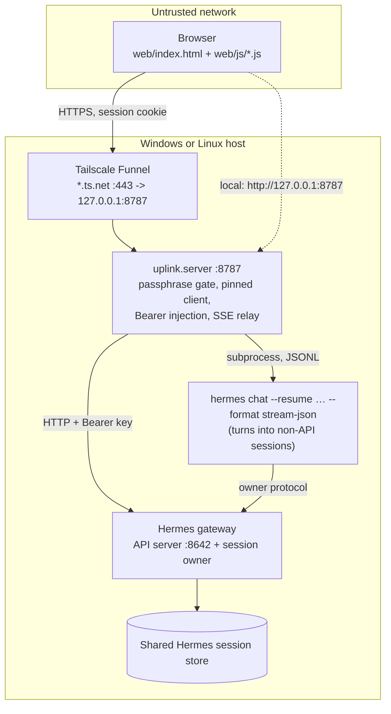
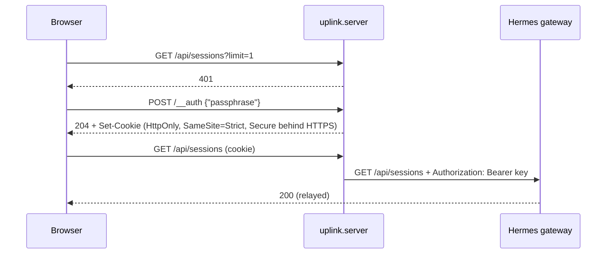

# Hermes Uplink: Architecture

Uplink is a zero-build browser client plus a loopback-only proxy for [Hermes Agent](https://hermes-agent.nousresearch.com/). The proxy gates access with a passphrase, injects the Hermes API key server-side, and serves the pinned static client. Internet exposure is owned entirely by Tailscale Funnel; nothing in this repository stores tunnel credentials.

Design constraints:

- **No build step.** Plain HTML, CSS, and native ES modules with one vendored dependency (`marked`); Python standard library only (the one exception, `uplink/interrupt_helper.py`, runs inside Hermes's own runtime).
- **Loopback only.** The proxy binds 127.0.0.1; the API key never reaches the browser.
- **Pinned assets.** Served code is authorized by SHA-256 digests; the proxy refuses to start if a file drifts and serves only the bytes it verified.
- **Shared sessions.** Sessions live in the Hermes store, so Uplink, CLI, TUI, and cron see the same conversations.
- **Frugal connectivity.** No background polling: refresh on focus/visibility, last-render cache, draft autosave, SSE keepalive.

## Components



Python runs as modules of the `uplink` package from the repository root (`python -m uplink.server`); the launchers `cd` there first.

| Path | Role |
|---|---|
| [uplink/server.py](uplink/server.py) | The proxy: routing, passphrase gate, API forwarding and SSE relay, HTTP limits |
| [uplink/auth.py](uplink/auth.py) | Browser-session tokens and the failed-attempt limiter |
| [uplink/assets.py](uplink/assets.py) | The client in `web/`: served files, digest pins, CSP; `python -m uplink.assets --update` / `--check` |
| [uplink/native.py](uplink/native.py) | Turns into sessions the API server does not own: runs the Hermes CLI and translates its events (see Streaming) |
| [uplink/interrupt_helper.py](uplink/interrupt_helper.py) | Stop for those turns; run by Hermes's interpreter, not Uplink's |
| [uplink/funnel.py](uplink/funnel.py) | Tailscale Funnel lifecycle: status parsing, ownership guard, consent URL handling |
| [uplink/configure.py](uplink/configure.py) | First-run setup: validates settings, creates credentials, and configures and restarts the Hermes gateway |
| [uplink/settings.py](uplink/settings.py) | Defaults, host paths, credential files, and the Windows console helper shared by the above |
| [web/](web/) | The client: `index.html`, `app.css`, `js/` (ES modules, below), `sw.js`, `manifest.webmanifest`, `vendor/marked.umd.js`, `assets/` |
| [web/pinned-hashes.json](web/pinned-hashes.json) | SHA-256 digests of every `.html`, `.js`, and `.css` file the proxy serves |
| [launch_local.bat](launch_local.bat), [launch_local.sh](launch_local.sh) | Setup then the proxy in the foreground; `install` / `start` / `stop` / `status` / `uninstall` manage the background proxy (Windows Startup folder; Linux `hermes-uplink` systemd user unit, which supervises the process) |
| [launch_internet.bat](launch_internet.bat), [launch_internet.sh](launch_internet.sh) | Wrappers for `python -m uplink.funnel` |
| [windows/](windows/) | `autostart.vbs` (headless start at login) and `service.ps1` (PID-checked stop/status) |

The proxy takes the API key and passphrase from the `HERMES_API_KEY` / `UPLINK_PASSPHRASE` environment variables, falling back to the git-ignored `.uplink-key.txt` / `.uplink-pass.txt` that `uplink.configure` creates. Credential formats are validated in one place, `uplink/settings.py`.

### Client modules

`index.html` loads two scripts, each pinned by SRI: `vendor/marked.umd.js` and `js/boot.js`, which inserts the entry module `js/main.js` (see the security model for why). Modules share state through [web/js/state.js](web/js/state.js): values several modules reassign live on its `state` object, everything else stays private to its module.

| Module | Owns |
|---|---|
| `main.js` | Wiring of page controls, boot, focus/online/pagehide handlers |
| `state.js` | Shared state, persisted preferences, `foregroundStream()` |
| `api.js` | Requests to the proxy, gateway capability flags |
| `connection.js` | Passphrase gate, offline banner, status dot, Connection dialog |
| `layout.js` | Sidebar pinning and flyouts, skills/toolsets panel, More menu |
| `sessions.js` | Session list, unread and attention markers, opening/creating sessions, history, refresh |
| `stream.js` | Turns: the chat stream, SSE frame handling, send and stop |
| `thread.js` | Message bubbles, tool and thought cards, history rendering, message actions |
| `clarify.js` | Clarify cards (single, multi-select, batch) and their recovery |
| `composer.js` | The message box, drafts, and the send/stop ring with context usage |
| `models.js` | The model chip and picker |
| `markdown.js` | Markdown and Hermes system-note rendering, link sanitizing |
| `util.js` | Stateless helpers |

`sw.js` exists only to make the app installable; it caches nothing, because a cached copy of a pinned file could only be a stale one.

## Authentication and sessions

`/api/*`, `/v1/*`, and `/health` require a session cookie. The browser probes `/api/sessions`; a transport failure shows the offline banner, a `401` shows the passphrase modal.



Passphrase failures are limited to 10 per 60 s per client address (the correct passphrase is never locked out). Sessions last 12 h, at most 256 at a time. At most 32 proxy requests run concurrently (excess get `503`) and 128 connections (excess are dropped).

## Streaming

The client opens `POST /api/sessions/{id}/chat/stream` with `Idempotency-Key` / `X-Client-Turn-ID` set to a per-draft UUID that is kept until the stream is established, so a retried send reuses it. The proxy relays the SSE body unbuffered, closes the connection to delimit it, and writes `: ping` every 15 s of upstream silence to keep cellular NAT mappings alive; the client ignores comment frames.

Frames consumed by `handleFrame` in `web/js/stream.js` (the gateway is authoritative): `assistant.delta {delta}`, `assistant.commentary {text, already_streamed}`, `assistant.completed {content}`, `tool.started` / `tool.completed` / `tool.failed {tool_name, preview, args}`, `error {message}`, `run.completed`, and the clarify events below. Frames carry `run_id`; Stop aborts the fetch and calls `POST /v1/runs/{run_id}/stop`.

**Sessions the API server does not own.** Hermes gives each conversation one owning surface, and the API server admits turns only into sessions it created (`source` `api_server` or `bot_room`); a send into a session created by the desktop app, CLI, TUI, or a messaging platform is refused with `permission_denied`. The proxy therefore looks up the session's `source` before each send. API-owned sessions stream over REST as above. Every other session's turn runs through the documented CLI interface `hermes chat --resume <id> --oneshot --query-file - --format stream-json`, which submits through the session's owner exactly as the desktop app does; [uplink/native.py](uplink/native.py) translates its JSONL (`text`, `tool_use`, `tool_result`, `result`) into the frames above, so the client cannot tell the paths apart. The interpreter and bootstrap come from `hermes --print-runtime-command`. Killing that CLI only detaches it (the owner keeps running the turn), so these turns get a proxy-issued `run_id` (`uplink-native-…`) and Stop runs [uplink/interrupt_helper.py](uplink/interrupt_helper.py), which sends the owner's `session.interrupt` the way the CLI's `/stop` does. What this path lacks: clarify cards (a one-shot turn's clarify returns "no user available; use your judgment"), and approvals follow `approvals.single_query_mode` (default deny). Set `HERMES_CLI` or `--hermes-cli` when `hermes` is not on the proxy's PATH; without it these sessions stay read-only.

Streams are tracked per session (the `streams` map in `state.js`); the session on screen's running stream is derived from it (`foregroundStream()`), never mirrored. Leaving a session parks its thread nodes in a detached holder, the stream keeps writing there, and the session row shows "new reply" or "question waiting" until the user returns. `localThread` marks threads holding stream-built content so passive refreshes do not overwrite them.

Clarify (interactive questions) is specified in [docs/clarify-protocol.md](docs/clarify-protocol.md).

## Client state

- **Sidebar:** a drawer below 768 px or in portrait; pinnable at ≥1024 px or ≥768 px landscape (preference in `localStorage`). The main header collapses to two rows plus a More menu by container width.
- **Drafts:** saved per session in `localStorage`; cleared only once a stream is established; reconciled against history so a send that reached the server is not repeated.
- **Last-render cache:** `sessionRenderCache` per session; a failed history fetch never blanks an existing thread.
- **Unread:** the session list carries `unread`; opening a session PATCHes `{unread:false}` after history loads. A local write guard (10 s) stops a stale list page from flipping it back. Details and the planned activity status: [docs/session-status.md](docs/session-status.md).

## Security model

| Threat | Control |
|---|---|
| Unauthenticated public ingress | Funnel terminates TLS; proxy passphrase gate with constant-time compare and attempt limiting |
| API key exfiltration | Key stays in the proxy process; the browser holds only an opaque cookie |
| Tampered or injected scripts | Digest-pinned files, verified at startup and served from memory; CSP `default-src 'none'`, `connect-src 'self'`, `script-src 'strict-dynamic'` with only the digests of the two scripts `index.html` names (each also SRI-checked), `script-src-attr 'none'` |
| Path traversal in static serving | Files are served from an in-memory map keyed by URL path; nothing is resolved against the filesystem per request |
| Host pivoting | Loopback bind only; non-loopback upstreams require `--allow-remote-upstream` and HTTPS |
| Overwriting another Funnel/Serve config | `matching_uplink_route` refuses any other public route on 443; cleanup disables only a verified Uplink route |

`'strict-dynamic'` extends trust only to scripts a trusted script inserts as elements; Chrome blocks a `<script type="module">` written in the HTML together with its static imports, and an `import()` from a trusted classic script. That is why `js/boot.js` inserts `js/main.js` as an element: the module graph below it is then trusted, and the proxy pins every module. Because of the CSP, UI code must not use inline `<script>`, inline `style=""` attributes, or `onclick=""` attributes; use classes and listeners. CSSOM writes such as `style.setProperty` are allowed.

## Funnel lifecycle

`launch_internet.bat start` (or `./launch_internet.sh start`) runs `python -m uplink.funnel start`, which: ensures the local proxy is healthy (if not, opening `launch_local.bat` in a new console on Windows, or running `launch_local.sh start` in the current terminal on Linux), loads the passphrase, ensures Tailscale is signed in (opening the consent URL it prints), reads `tailscale funnel status --json`, and either accepts the existing Uplink route, fails closed on a foreign route, or runs `tailscale funnel --bg --yes --https=443 http://127.0.0.1:<port>` and re-verifies. `status` and `cleanup` use the same ownership check.

On Linux, `tailscaled` accepts configuration changes only from root or its operator, so Funnel setup needs `sudo tailscale set --operator=$USER` once; `TailscaleCommandError` appends that hint to an access-denied failure.

## Operations

After editing any `.html`, `.js`, or `.css` file in `web/`:

```sh
python -m uplink.assets --update   # rewrites web/pinned-hashes.json and index.html's SRI digests
python -m uplink.assets --check    # exit 1 on drift
python -m unittest discover -s tests -v
```

Text files are hashed and served with LF line endings, so a CRLF checkout does not break the pins. Manual probes:

```sh
curl -s http://127.0.0.1:8642/health                       # gateway
curl -s -i http://127.0.0.1:8787/api/sessions              # expect 401
powershell -NoProfile -File .\windows\service.ps1 -Action status -Port 8787   # Linux: ./launch_local.sh status
python -m uplink.funnel status
```

CI runs the unit tests on Windows and Ubuntu and lints the shell launchers with shellcheck.
